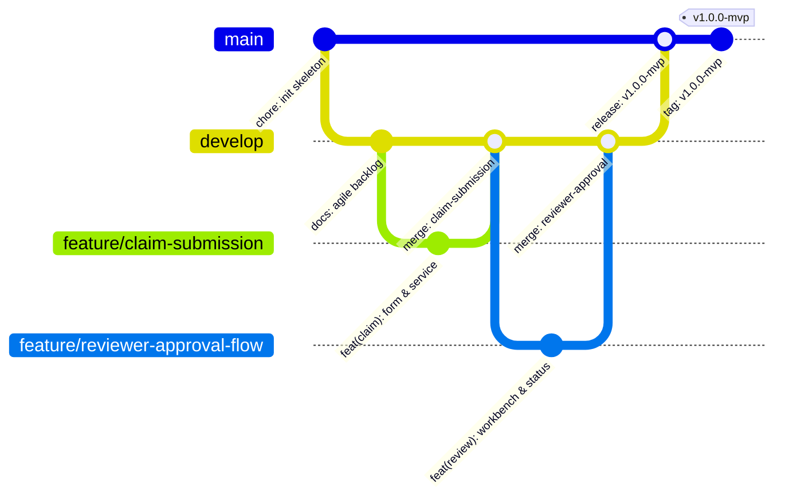

# Git Branching Strategy & Collaboration Policy
## Motor Insurance Claim Portal

---

### 1. GitFlow Architecture Overview
The repository follows a modified GitFlow branching model designed for continuous integration, predictable release tagging, and rapid hotfixes.



---

### 2. Branch Hierarchy and Responsibilities

| Branch Name | Base Branch | Merges Into | Protection Rules | Purpose |
| :--- | :--- | :--- | :--- | :--- |
| `main` / `master` | — | — | Protected; Requires PR, passing CI, 1 approval. | Production-ready stable code. Every commit is tagged with semantic version. |
| `develop` | `main` | `main` | Protected; Requires PR, passing CI. | Integration branch for nightly builds and staging tests. |
| `feature/<name>` | `develop` | `develop` | Short-lived; Deleted after merge. | Isolated feature development (e.g., `feature/claim-submission`). |
| `release/<version>` | `develop` | `main` & `develop` | Code freeze for QA and staging validation. | Release stabilization (e.g., `release/v1.0.0`). |
| `hotfix/<name>` | `main` | `main` & `develop` | Emergency fix branch. | Critical production fixes directly branched from `main`. |

---

### 3. Branch Naming Conventions
- `feature/<feature-description>`: e.g., `feature/claim-submission`, `feature/reviewer-approval-flow`
- `bugfix/<issue-id>-<short-description>`: e.g., `bugfix/issue-42-date-picker-format`
- `hotfix/<version>-<short-description>`: e.g., `hotfix/v1.0.1-security-patch`
- `release/<version>`: e.g., `release/v1.0.0-mvp`

---

### 4. Commit Message Standard (Conventional Commits)
All commit messages must follow the standard convention:
```
<type>(<scope>): <short imperative description>

[optional body explaining why and context]

[optional footer, e.g., Closes #12]
```

#### Allowed Types:
- `feat`: A new user-facing feature.
- `fix`: A bug fix.
- `docs`: Documentation updates.
- `style`: Formatting, missing semicolons, no code changes.
- `refactor`: Refactoring production code without changing behavior.
- `test`: Adding or correcting tests (JUnit, Selenium).
- `chore`: Build scripts, dependencies, CI/CD configuration.
- `ci`: Jenkins, Docker, or Ansible updates.

---
**Status**: APPROVED & ACTIVE
