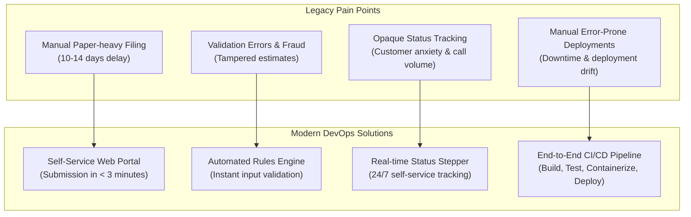

# Task 1: Problem Definition and Scope
## CI/CD Pipeline for a Motor Insurance Claim Portal

---

### 1. Executive Summary & Real-Time Need
Motor insurance claim processing in traditional enterprise environments is burdened by fragmented legacy workflows, physical paperwork, manual data entry, and opaque communication. When policyholders experience an accident, they face high friction:
- Extended filing delays (10–14 days average cycle time).
- Unpredictable document requests and missing information.
- Call-center congestion caused by customers seeking basic status updates.
- Underwriting and surveyor friction in reviewing damage assessments, leading to fraud risks and processing overhead.

To resolve these systemic inefficiencies, this project engineers a modern, cloud-native **Motor Insurance Claim Portal** supported by a fully automated **Continuous Integration and Continuous Deployment (CI/CD)** pipeline. The system provides instantaneous online claim registration, automated data/document validation, surveyor review portals, real-time claim status tracking, and automated deployment via Jenkins, Docker, and Ansible.

---

### 2. Target Users & Stakeholders

| Stakeholder / User Role | Description | Key Needs & Expectations |
| :--- | :--- | :--- |
| **Policyholder / Vehicle Owner** | Primary end-user reporting accident damage. | Frictionless claim submission (<3 min), instant claim number generation, 24/7 transparent tracking without calling support. |
| **Claim Reviewer / Field Surveyor** | Insurance adjuster inspecting vehicular damage and estimating repair costs. | Consolidated reviewer dashboard, fast decisioning (Approve/Reject), audit trail comments, fast status updates. |
| **Claims Operations Manager** | Business lead overseeing claim turnaround metrics and fraud management. | Real-time operational metrics, SLA compliance reports, reduced adjudication latency. |
| **DevOps & Platform Engineer** | Engineers managing application reliability and CI/CD automation. | Automated build, automated Selenium regression testing, zero-downtime deployment, immutable Docker artifacts, repeatable Ansible provisioning. |
| **Authorized Garage / Repair Center** | Network repair partners executing vehicle repairs. | Reliable claim approval references, clear claim settlement statuses. |

---

### 3. Existing Pain Points & Strategic Objectives

#### Measurable Success Criteria
1. **Submission Speed**: Reduce average claim submission time from 45 minutes of paperwork to **< 3 minutes**.
2. **Adjudication Cycle**: Accelerate initial review and decision turnaround from 14 days to **under 48 hours**.
3. **Tracking Transparency**: 100% of claims immediately queryable via unique reference numbers (`CLM-YYYY-XXXX`).
4. **Pipeline Velocity**: Automated commit-to-deployment time of **< 5 minutes**.
5. **Quality Gate**: Minimum **80% unit/integration test coverage** with mandatory automated Selenium regression passing before staging deployment.
6. **Availability & Resilience**: **99.9% uptime** with zero-downtime rolling container updates and automated rollback capability.

---

### 4. Constraints & Assumptions

- **Regulatory & Data Security**: Vehicular registration and personally identifiable information (PII) must comply with statutory data protection standards.
- **Technology Stack**: Platform-agnostic Java 21 LTS runtime with zero proprietary licensing dependencies.
- **Portability**: The application must run identically in local developer environments, bare-metal servers, and containerized Docker runtimes.
- **Audit Compliance**: All state changes (SUBMITTED -> UNDER_REVIEW -> APPROVED/REJECTED) must record immutable reviewer comments and timestamps.

---

### 5. Approved 15-Task MVP Scope

The minimum viable product (MVP) and supporting DevOps lifecycle are frozen into 15 focused tasks:

| Task # | Task Title | Description & Scope | Primary Deliverable |
| :---: | :--- | :--- | :--- |
| **1** | **Problem Definition & Scope** | Real-time need, pain points, stakeholders, constraints, success metrics, MVP freeze. | Problem definition & scope document. |
| **2** | **Agile Planning & DevOps Workflow** | Epics, user stories, Gherkin criteria, product backlog, 3-sprint plan, Definition of Done, DevOps lifecycle. | Backlog, Kanban plan, DoD & lifecycle diagram. |
| **3** | **Requirements & Architecture** | Functional/non-functional specs, use-case diagram, 3-tier architecture, data model, REST APIs. | SRS summary, architecture & API schema. |
| **4** | **Git & GitHub Repository Init** | Git repo setup, .gitignore, README, GitHub issue templates, PR template, branching policy. | Initialized Git repo, skeleton commit, branching policy. |
| **5** | **Feature 1: Claim Submission** | Feature branch development, domain model, DTOs, service, controller, submission form, PR & merge. | Working submission feature, Git branch & merge evidence. |
| **6** | **MVP Completion & Collaboration** | Validation rules, reviewer workbench, approval/rejection flow, status tracking, merge conflict resolution, v1.0.0 tag. | Complete MVP, conflict resolution, Git release tag. |
| **7** | **Jenkins CI Job Setup** | Jenkins service, JDK/Maven integration, GitHub/poll trigger, clean package build, artifact archiving. | Configured Jenkins CI job, build logs & archived JAR. |
| **8** | **Pipeline as Code (Jenkinsfile)** | Declarative Jenkinsfile with parameterized environment, checkout, build, package, deploy stages. | Jenkinsfile, pipeline run log, deployed app URL. |
| **9** | **Selenium Test Automation** | 4 critical user journeys (submission, tracking, approval, validation failure), POM, failure screenshots. | Selenium test suite, local test report & screenshots. |
| **10** | **Continuous Testing in Jenkins** | Integrate Selenium into Jenkinsfile, JUnit test reports, pipeline quality gate, defect induction & fix rerun. | Jenkins test report, failure gating & defect fix rerun. |
| **11** | **Docker Image & Container Lifecycle** | Multi-stage Dockerfile, image build & tagging, run container, port mapping, lifecycle management script. | Dockerfile, container commands, running container proof. |
| **12** | **Jenkins-Docker CD Pipeline** | Versioned Docker image packaging, registry push, automated container replacement & health check. | Automated Jenkins Docker CD pipeline & registry push. |
| **13** | **Configuration Management** | Server prerequisites specification, Ansible inventory, playbook & structured roles, Puppet manifest. | Ansible playbook/roles, Puppet manifest & syntax logs. |
| **14** | **Provisioning & Reliability Validation** | Automated provisioning run, idempotency verification (`changed=0`), HTTP health check, automated rollback. | Idempotency log, health-check script, rollback run. |
| **15** | **Capstone Project Synthesis** | End-to-end verification, master project documentation, portfolio showcase, release bundle. | Master project report and artifact bundle. |

---
**Status**: APPROVED & FROZEN
