# Task 2: Agile Planning and DevOps Workflow
## Motor Insurance Claim Portal

---

### 1. Agile Framework & Sprint Architecture
The development and operations lifecycle for the Motor Insurance Claim Portal is structured around **Scrum** for iterative feature delivery and **Kanban** for continuous flow, build automation, and infrastructure operations. The project is executed in three targeted 2-week Sprints:

- **Sprint 1 (Foundation & Core MVP)**: Architecture, Git workflow, Claim Submission, Reviewer Portal, and Status Tracking.
- **Sprint 2 (Continuous Integration & Quality Engineering)**: Jenkins CI pipeline, Selenium E2E automated test suite, Quality Gates, and artifact archiving.
- **Sprint 3 (Continuous Delivery & Infrastructure Automation)**: Docker containerization, Jenkins-Docker CD pipeline, Ansible configuration management, automated provisioning, and rollback validation.

---

### 2. User Stories & Gherkin Acceptance Criteria

#### User Story 1: Digital Claim Submission
> **As a** vehicle policyholder who has experienced an accident,  
> **I want to** submit my claim details online through a secure form,  
> **So that** I do not have to visit a physical insurance branch or mail paper documents.

```gherkin
Scenario: Successful motor insurance claim submission
  Given the policyholder is on the claim submission page "/submit"
  When they enter valid policy number "POL-123456", name "Rajesh Kumar", phone "9876543210", vehicle number "MH12AB1234", incident date in the past, and amount "25000.00"
  And click the "Submit Claim" button
  Then the system generates a unique reference number formatted as "CLM-YYYY-XXXX"
  And redirects to the confirmation page displaying the generated reference number
  And initializes the claim status to "SUBMITTED"
```

#### User Story 2: Automated Data Validation
> **As an** insurance risk analyst,  
> **I want** the system to enforce strict validation rules on all incoming claim fields,  
> **So that** invalid vehicle numbers, future dates, or negative amounts are blocked immediately.

```gherkin
Scenario: Rejection of future incident date
  Given the claimant enters an incident date that is in the future
  When they submit the form
  Then the form is rejected with HTTP 400 or client-side validation
  And an inline error message states "Incident date cannot be in the future"
  And no record is committed to the database
```

#### User Story 3: Surveyor Reviewer Workbench
> **As an** insurance claim reviewer / surveyor,  
> **I want to** view all submitted claims on a dedicated workbench and filter by status,  
> **So that** I can assess damage estimates, inspect details, and adjudicate efficiently.

```gherkin
Scenario: Reviewer evaluates and approves a pending claim
  Given the reviewer is logged in to "/reviewer"
  When they select claim "CLM-2026-X1Y2" in "SUBMITTED" state
  And select decision "APPROVED" with remarks "Damage inspected and approved"
  And submit the decision
  Then the claim status transitions to "APPROVED"
  And the reviewer remarks and updated timestamp are saved to the audit record
```

#### User Story 4: Real-Time Self-Service Tracking
> **As a** policyholder,  
> **I want to** search my claim by reference number on the portal 24/7,  
> **So that** I know exactly which stage my claim is in without calling customer care.

```gherkin
Scenario: Tracking an active claim
  Given a policyholder enters reference "CLM-2026-X1Y2" on the tracking page "/track"
  When they click the "Track" button
  Then the system displays the claim progress stepper indicating the current status
  And shows policy details, vehicle number, and surveyor comments
```

---

### 3. Product Backlog & Sprint Allocation

| ID | Item / Feature Description | Priority | Story Points | Sprint | Status |
| :---: | :--- | :---: | :---: | :---: | :---: |
| **PB-01** | Git repo initialization, branch conventions, and CI/CD templates | High | 3 | Sprint 1 | Done |
| **PB-02** | Core Domain Model, JPA Repositories, and H2/MySQL schema | High | 5 | Sprint 1 | Done |
| **PB-03** | Web Claim Submission Form with server-side validation | High | 5 | Sprint 1 | Done |
| **PB-04** | REST API endpoints for claim ingestion and metrics | Medium | 3 | Sprint 1 | Done |
| **PB-05** | Surveyor Reviewer Workbench with approval/rejection actions | High | 5 | Sprint 1 | Done |
| **PB-06** | Self-service Claim Status Tracking stepper view | High | 3 | Sprint 1 | Done |
| **PB-07** | Git branching, merge conflict creation and resolution demo | Medium | 2 | Sprint 1 | Done |
| **PB-08** | Jenkins CI service installation and FreeStyle/Maven build job | High | 5 | Sprint 2 | Done |
| **PB-09** | Declarative Jenkinsfile (Pipeline-as-Code) with parameters | High | 5 | Sprint 2 | Done |
| **PB-10** | Selenium WebDriver 4 automated test suite (4 user journeys) | High | 8 | Sprint 2 | Done |
| **PB-11** | Jenkins Continuous Testing integration & Defect gating gate | High | 5 | Sprint 2 | Done |
| **PB-12** | Multi-stage Dockerfile and container lifecycle scripts | High | 5 | Sprint 3 | Done |
| **PB-13** | Jenkins-Docker Continuous Deployment pipeline | High | 8 | Sprint 3 | Done |
| **PB-14** | Ansible configuration management playbooks and roles | High | 5 | Sprint 3 | Done |
| **PB-15** | Automated provisioning, idempotency, health check & rollback | High | 5 | Sprint 3 | Done |

---

### 4. Definition of Done (DoD) Checklist

For any user story or pipeline task to be declared **"Done"**, it must satisfy:
1. **Code Standards**: Java code adheres to clean code practices, meaningful naming, and proper docstrings.
2. **Local Tests**: Unit and integration tests achieve >= 80% business logic branch coverage (`mvn test` passes cleanly).
3. **E2E Automation**: Selenium WebDriver end-to-end tests pass in headless mode; failure screenshot handler is operational.
4. **Git Discipline**: Work is completed on a dedicated feature branch, code-reviewed, and merged into `develop`/`main` with zero unresolved merge markers.
5. **Jenkins CI Verification**: Jenkins pipeline executes successfully (Build -> Test -> Package) with green status and archived artifacts.
6. **Container Hygiene**: Docker image builds cleanly via multi-stage Dockerfile, executes under a non-root user, and exposes health probes.
7. **Infrastructure as Code**: Ansible playbooks execute with zero syntax errors, are strictly idempotent (`changed=0` on second run), and support automated rollback.

---

### 5. DevOps Lifecycle Architecture Diagram

```mermaid
flowchart LR
    subgraph PlanCode ["1. Plan & Code"]
        A["Agile Backlog<br/>(User Stories)"] --> B["Git Branching<br/>(feature/branch)"]
        B --> C["Pull Request<br/>& Code Review"]
    end

    subgraph CI ["2. Continuous Integration (Jenkins)"]
        C --> D["Git Webhook / SCM Poll"]
        D --> E["Maven Compile<br/>& Unit Tests"]
        E --> F["Selenium E2E Tests<br/>(Quality Gate)"]
        F --> G["Package Artifact<br/>(claim-portal.jar)"]
    end

    subgraph Containerize ["3. Containerization & Registry"]
        G --> H["Docker Multi-Stage Build"]
        H --> I["Tag Version & SHA"]
        I --> J["Docker Registry / Hub"]
    end

    subgraph CDDeploy ["4. Continuous Deployment & Ops"]
        J --> K["Ansible Playbook / Deploy"]
        K --> L["Target Server / Container"]
        L --> M["Health Check Probe<br/>(/actuator/health)"]
        M -->|Success| N["Live Production Traffic"]
        M -->|Failure| O["Automated Rollback<br/>to Previous Stable"]
    end
```



---
**Status**: COMPLETE & VERIFIED
