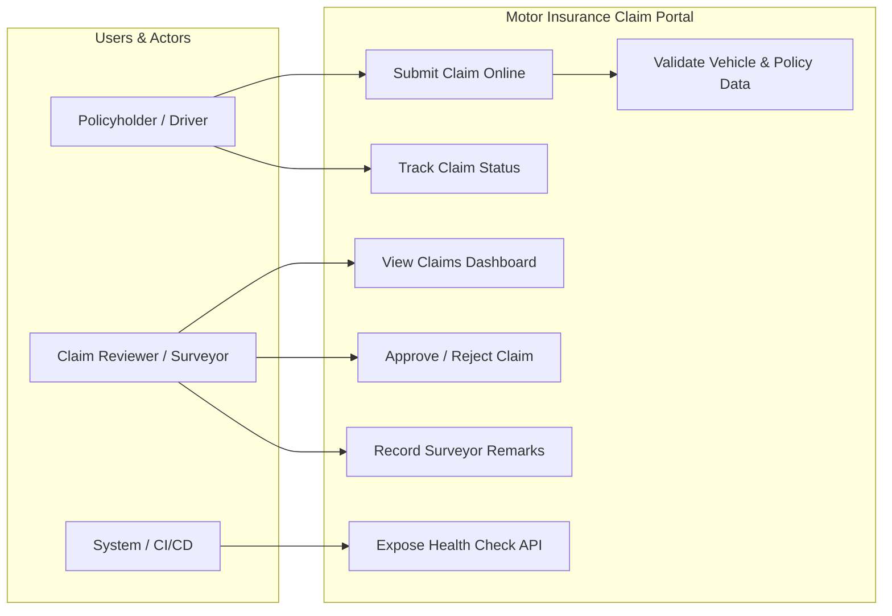
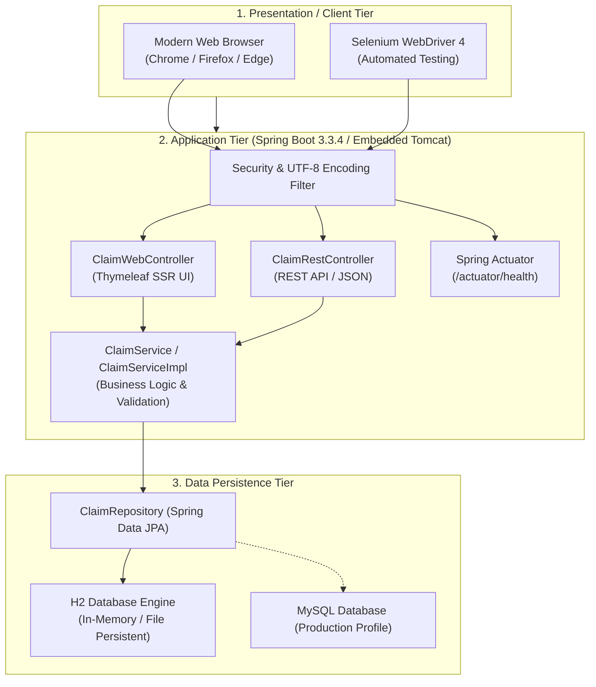

# Task 3: Requirements, Architecture and Technology Setup
## Motor Insurance Claim Portal

---

### 1. Software Requirements Specification (SRS) Summary

#### 1.1 Functional Requirements (FR)
- **FR-01 (Claim Registration)**: The system shall provide a web form for policyholders to enter policy details, vehicle registration number, incident date/location, repair estimate, and incident description.
- **FR-02 (Unique Identifier Generation)**: Upon successful submission, the system shall generate an immutable, human-readable claim reference number (format: `CLM-YYYY-XXXX`).
- **FR-03 (Automated Input & Data Validation)**:
  - Policy numbers must follow alphanumeric patterns (6–25 chars).
  - Vehicle registration numbers must follow standard alphanumeric patterns.
  - Incident dates must be on or before the current date (`@PastOrPresent`).
  - Estimated damage amount must be between ₹100.00 and ₹5,000,000.00.
  - Description must be between 10 and 1,000 characters.
- **FR-04 (Reviewer Workbench)**: Claim adjusters shall have a workbench listing all claims with status filtering (`ALL`, `SUBMITTED`, `APPROVED`, `REJECTED`).
- **FR-05 (Adjudication Actions)**: Reviewers shall be able to update claim status to `APPROVED` or `REJECTED` and provide mandatory surveyor remarks.
- **FR-06 (Self-Service Status Tracking)**: Any user with a valid claim reference number can query real-time status and view the visual progress stepper.
- **FR-07 (Health & Monitoring API)**: The application shall expose standard Actuator health endpoints (`/actuator/health`) for automated CI/CD and container monitoring.

#### 1.2 Non-Functional Requirements (NFR)
- **NFR-01 (Performance)**: Page load time < 1.5 seconds; API response time for claim submission < 500 ms under standard load.
- **NFR-02 (Reliability & Availability)**: 99.9% uptime target supported by automated container restarts and health-probe recovery.
- **NFR-03 (Security)**: Input sanitization to prevent XSS and SQL injection; parameterized database access via Spring Data JPA.
- **NFR-04 (Portability)**: Cross-platform capability across Linux, Windows, macOS, and container runtimes (Docker/OCI).
- **NFR-05 (Maintainability)**: Clear separation of concerns following MVC / N-tier architecture; automated test suites covering core business logic.

---

### 2. Use-Case Diagram



---

### 3. Application Architecture Diagram

The portal follows an enterprise 3-tier layered architecture containerized and deployed across CI/CD stages:



---

### 4. Data Model & REST API Specification

#### 4.1 Data Model Entity: `Claim`

```mermaid
erDiagram
    CLAIM {
        bigint id PK "Auto-increment ID"
        varchar(32) claim_number UK "e.g. CLM-2026-A1B2"
        varchar(32) policy_number "Policy number"
        varchar(100) claimant_name "Full name of claimant"
        varchar(100) claimant_email "Email address"
        varchar(20) claimant_phone "Contact number"
        varchar(20) vehicle_number "e.g. MH12AB1234"
        date incident_date "Accident date"
        varchar(200) incident_location "Accident location"
        decimal(12,2) estimated_amount "Repair estimate"
        varchar(1000) description "Accident description"
        varchar(20) status "SUBMITTED / UNDER_REVIEW / APPROVED / REJECTED"
        varchar(1000) reviewer_comments "Surveyor notes"
        timestamp created_at "Creation timestamp"
        timestamp updated_at "Modification timestamp"
    }
```

#### 4.2 REST API Specification

| Method | Endpoint | Description | Request Body | Response Codes |
| :---: | :--- | :--- | :--- | :--- |
| `POST` | `/api/claims` | Submit new claim | `ClaimSubmissionRequest` (JSON) | `201 Created`, `400 Bad Request` |
| `GET` | `/api/claims` | List claims (optional filter `?status=`) | None | `200 OK` |
| `GET` | `/api/claims/{id}` | Get claim by database ID | None | `200 OK`, `404 Not Found` |
| `GET` | `/api/claims/track/{claimNumber}` | Track claim by public reference | None | `200 OK`, `404 Not Found` |
| `PUT` | `/api/claims/{id}/review` | Adjudicate claim (Approve/Reject) | `ReviewActionRequest` (JSON) | `200 OK`, `400 Bad Request`, `404 Not Found` |
| `GET` | `/api/claims/stats` | Pipeline metrics summary | None | `200 OK` |
| `GET` | `/actuator/health` | Application health check | None | `200 OK {"status":"UP"}` |

---

### 5. Technology Stack Selection Rationale

| Layer / Concern | Chosen Technology | Version | Rationale |
| :--- | :--- | :--- | :--- |
| **Language & SDK** | Java Development Kit (JDK) | 21 LTS | Long-term support, high performance, virtual threads, rock-solid stability. |
| **Application Framework** | Spring Boot | 3.3.4 | Industry standard, auto-configuration, robust dependency injection, embedded Tomcat. |
| **Web & UI Engine** | Spring MVC + Thymeleaf | 3.x | Clean Server-Side Rendering (SSR) without complex Node.js build pipelines; instant Selenium testability. |
| **Frontend Styling** | Bootstrap 5 + Bootstrap Icons | 5.3.3 | Responsive modern design, mobile-ready layout, zero build dependencies. |
| **Build & Dependency Tool** | Apache Maven | 3.9.16 | Standard lifecycle (`compile`, `test`, `package`), multi-plugin ecosystem, reproducible builds. |
| **Database** | H2 Database / MySQL | 2.x | Zero-config in-memory testing for CI pipelines with seamless MySQL driver compatibility for production. |
| **Automated Testing** | JUnit 5 + Mockito + Selenium | 4.25.0 | Complete testing pyramid: fast unit tests, MVC integration tests, and headless browser E2E journeys. |
| **Continuous Integration** | Jenkins LTS | 2.x | Automated SCM polling, declarative pipeline-as-code, surefire test reports, artifact archiving. |
| **Containerization** | Docker | Engine / OCI | Multi-stage image build, immutable artifacts, environment parity from dev to prod. |
| **Configuration Management** | Ansible | 2.10+ | Agentless YAML-based configuration, idempotency, automated rollback, systemd management. |

---

### 6. Local Development Setup Instructions

1. **Prerequisites**:
   - JDK 21 installed (`java -version` returns 21+).
   - Maven 3.9+ installed (`mvn -version` returns 3.9+).
   - Google Chrome installed for Selenium E2E tests.

2. **Clone and Build**:
   ```bash
   git clone <repository-url>
   cd motor-insurance-claim-portal
   mvn clean compile
   ```

3. **Run Unit Tests**:
   ```bash
   mvn test -Dtest=ClaimServiceTest,ClaimRestControllerTest
   ```

4. **Run Application Locally**:
   ```bash
   mvn spring-boot:run
   ```
   Or execute the built artifact:
   ```bash
   mvn clean package -DskipTests
   java -jar target/claim-portal.jar
   ```

5. **Access Application**:
   - Web Portal: `http://localhost:8080/`
   - File Claim: `http://localhost:8080/submit`
   - Track Claim: `http://localhost:8080/track`
   - Reviewer Portal: `http://localhost:8080/reviewer`
   - H2 Console: `http://localhost:8080/h2-console` (JDBC URL: `jdbc:h2:mem:claimdb`)
   - Health Probe: `http://localhost:8080/actuator/health`

---
**Status**: COMPLETE & VERIFIED
