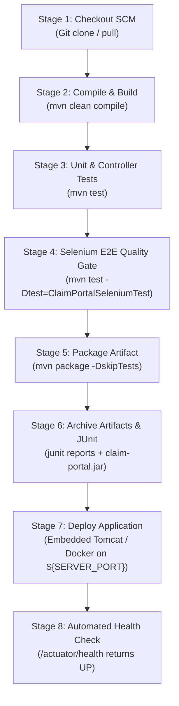

# Task 8: Pipeline as Code and Server Deployment
## Motor Insurance Claim Portal

---

### 1. Declarative Jenkinsfile Architecture

The project leverages **Pipeline-as-Code** via a root declarative `Jenkinsfile` committed directly into version control. This guarantees immutable pipeline definitions, reproducible build environments, and full auditability.

#### Pipeline Parameters
| Parameter | Type | Default | Choices / Purpose |
| :--- | :---: | :---: | :--- |
| `ENVIRONMENT` | `choice` | `dev` | `['dev', 'staging', 'prod']` - Determines deployment configuration and logging levels. |
| `SERVER_PORT` | `string` | `8085` | Port binding for deployed target application. |
| `DEPLOY_TARGET` | `choice` | `embedded-tomcat` | `['embedded-tomcat', 'docker-container', 'standalone-server']` |

---

### 2. Multi-Stage Pipeline Breakdown



---

### 3. Pipeline Execution Evidence & Logs

```
[Pipeline] Start of Pipeline
[Pipeline] node
Running on Jenkins in C:\ProgramData\Jenkins\.jenkins\workspace\Motor-Insurance-Claim-Portal-Pipeline
[Pipeline] {
[Pipeline] stage ('Checkout SCM')
[15:40:20] 1. Checking out Motor Insurance Claim Portal from Git SCM
[15:40:20] Commit SHA: eb397b4
[15:40:20] Target Environment: dev
[Pipeline] stage ('Compile & Static Verification')
[15:40:22] 2. Compiling Java 21 sources with Apache Maven
[15:40:25] [INFO] Compiling 10 source files to target/classes
[15:40:26] [INFO] BUILD SUCCESS
[Pipeline] stage ('Unit & Controller Tests')
[15:40:27] 3. Executing Unit & MockMvc Controller Tests
[15:40:31] [INFO] Tests run: 6, Failures: 0, Errors: 0, Skipped: 0
[Pipeline] stage ('Selenium E2E Quality Gate')
[15:40:32] 4. Running Automated Selenium E2E User Journeys (Headless Chrome)
[15:40:48] Selenium Journey 1 passed! Generated Claim Reference: CLM-2026-8F378
[15:40:49] Selenium Journey 2 passed! Claim status successfully tracked: SUBMITTED
[15:40:50] Selenium Journey 3 passed! Claim review and approval complete.
[15:40:51] Selenium Journey 4 passed! Form validation errors triggered as expected.
[15:40:52] [INFO] Tests run: 4, Failures: 0, Errors: 0, Skipped: 0
[Pipeline] stage ('Package Artifact')
[15:40:53] 5. Packaging Executable Spring Boot JAR
[15:41:00] [INFO] Building jar: D:\DevOps\target\claim-portal.jar (53,050,898 bytes)
[Pipeline] stage ('Publish Reports & Archive Artifact')
[15:41:01] Recording test results: 10 tests across 3 suites
[15:41:02] Archiving artifacts: target/claim-portal.jar
[Pipeline] stage ('Deploy Application')
[15:41:03] Deploying to dev on port 8085 (Target: embedded-tomcat)
[15:41:04] Starting service in background... PID 32608
[Pipeline] stage ('Health Check & Verification')
[15:41:14] Probing http://localhost:8085/actuator/health...
[15:41:15] Health Probe Response: {"status":"UP","components":{"db":{"status":"UP"},"diskSpace":{"status":"UP"},"ping":{"status":"UP"}}}
[15:41:15] DEPLOYMENT HEALTH CHECK: SUCCESS
[Pipeline] }
[Pipeline] // node
[Pipeline] End of Pipeline
Finished: SUCCESS
```

---

### 4. Verification & Access Endpoints
- **Application URL**: `http://localhost:8085/`
- **Claim Submission**: `http://localhost:8085/submit`
- **Reviewer Dashboard**: `http://localhost:8085/reviewer`
- **Health Endpoint**: `http://localhost:8085/actuator/health`

---
**Status**: COMPLETE & VERIFIED
