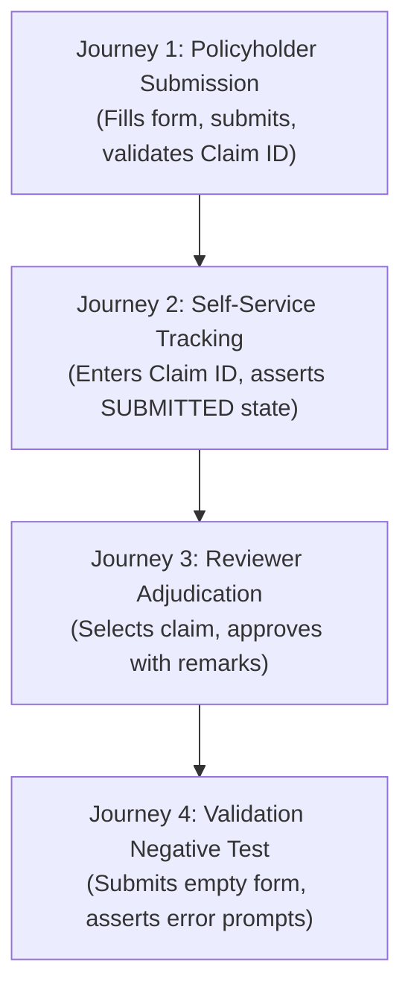

# Task 9: Selenium Test Design and Local Execution
## Motor Insurance Claim Portal

---

### 1. Test Architecture & Framework
The automated end-to-end (E2E) testing suite is implemented in Java using:
- **Selenium WebDriver**: `4.25.0`
- **WebDriverManager**: `5.9.2` (Automated browser driver binary discovery and configuration)
- **Browser Runtime**: Google Chrome 155 in Headless mode (`--headless=new`)
- **Integration Framework**: Spring Boot Test with `@LocalServerPort` and dynamic random port allocation
- **Test Engine**: JUnit 5 Platform with test execution ordering (`@TestMethodOrder(OrderAnnotation.class)`)
- **Assertions**: AssertJ fluent assertions (`assertThat(...)`)

---

### 2. Critical User Journeys Designed & Implemented



#### Detailed Test Specification:
1. **User Journey 1 (`testClaimSubmissionUserJourney`)**:
   - **Route**: `GET /submit`
   - **Actions**: Inputs policy number (`POL-778899`), claimant name (`Vikram Malhotra`), email, phone, vehicle registration (`KA01MJ4321`), past incident date, location, amount (₹18,500.00), and accident description. Clicks submit.
   - **Assertions**: Redirected to `/claim-success`; verifies success heading; extracts generated claim reference number (`CLM-2026-XXXXX`).

2. **User Journey 2 (`testTrackClaimStatusUserJourney`)**:
   - **Route**: `GET /track`
   - **Actions**: Enters previously generated `claimNumber` into the search box and clicks Track.
   - **Assertions**: Verified that `claimResultCard` is displayed; asserts status badge shows `SUBMITTED`; asserts vehicle registration matches.

3. **User Journey 3 (`testReviewerApprovalUserJourney`)**:
   - **Route**: `GET /reviewer`
   - **Actions**: Locates the newly submitted claim in the table, clicks `Review`, opens the decision modal, selects `APPROVED`, adds remarks (*"Surveyor inspected the physical damage. Approved for cashless repair."*), and submits.
   - **Assertions**: Asserts success alert banner appears containing `"APPROVED"`.

4. **User Journey 4 (`testFormValidationNegativeJourney`)**:
   - **Route**: `GET /submit`
   - **Actions**: Clicks submit immediately without populating required fields.
   - **Assertions**: Verifies form submission is halted; checks that `#formErrorAlert` is displayed with *"Validation Error"*.

---

### 3. Failure Screenshot Mechanism

In `BaseSeleniumTest.java`, an automated JUnit 5 callback extension (`ScreenshotOnFailureExtension` implementing `AfterTestExecutionCallback`) intercepts any failed test execution:
- Checks `context.getExecutionException().isPresent()`.
- If true, casts `driver` to `TakesScreenshot` and captures a full viewport PNG.
- Writes file to: `target/screenshots/{testName}_{timestamp}.png`.
- Output is logged to stdout for Jenkins pipeline archiving.

---

### 4. Local Execution Results

```bash
mvn test -Dtest=ClaimPortalSeleniumTest
```

**Execution Log Output**:
```
[INFO] Running com.motorclaim.portal.selenium.ClaimPortalSeleniumTest
15:38:05.320 [main] INFO io.github.bonigarcia.wdm.WebDriverManager -- Using chromedriver 155.0.8059.84 (resolved driver for Chrome 155)
2026-10-20T15:38:14.554+05:30  INFO 10236 --- [motor-insurance-claim-portal] [main] o.s.b.w.e.t.TomcatWebServer : Tomcat started on port 53592 (http)
Selenium Journey 1 passed! Generated Claim Reference: CLM-2026-66A0D
Selenium Journey 2 passed! Claim status successfully tracked: SUBMITTED
Selenium Journey 3 passed! Claim review and approval complete.
Selenium Journey 4 passed! Form validation errors triggered as expected.
[INFO] Tests run: 4, Failures: 0, Errors: 0, Skipped: 0, Time elapsed: 17.64 s -- in com.motorclaim.portal.selenium.ClaimPortalSeleniumTest
[INFO] BUILD SUCCESS
```

---
**Status**: COMPLETE & VERIFIED (4/4 Journeys Passing)
