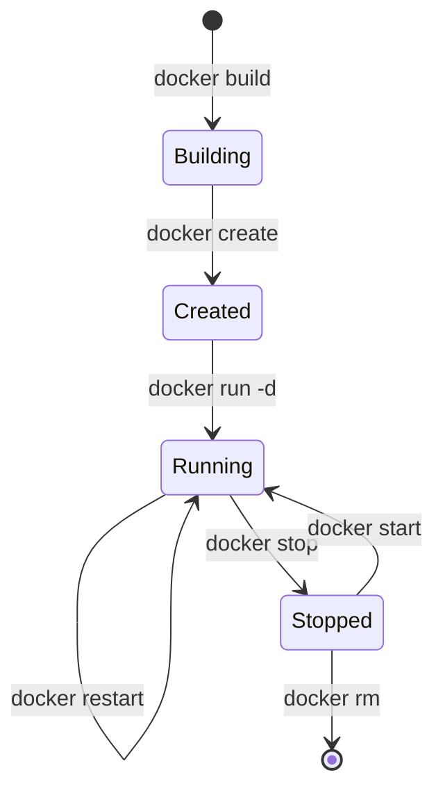

# Task 11: Docker Image and Container Lifecycle
## Motor Insurance Claim Portal

---

### 1. Dockerfile Architecture & Design Principles

The portal uses a **multi-stage build** Dockerfile designed to minimize attack surface, reduce artifact size, and ensure zero root privileges in production:

```dockerfile
# Stage 1: Build stage
FROM maven:3.9.6-eclipse-temurin-21 AS builder
WORKDIR /build
COPY pom.xml .
RUN mvn dependency:go-offline -B || true
COPY src ./src
RUN mvn clean package -DskipTests

# Stage 2: Runtime stage
FROM eclipse-temurin:21-jre-alpine
WORKDIR /app
RUN addgroup -S -g 1001 claimgroup && \
    adduser -S -u 1001 -G claimgroup claimuser && \
    mkdir -p /app/data && chown -R claimuser:claimgroup /app
COPY --from=builder --chown=claimuser:claimgroup /build/target/claim-portal.jar /app/claim-portal.jar
EXPOSE 8080
HEALTHCHECK --interval=30s --timeout=5s --start-period=20s --retries=3 \
    CMD wget -q --spider http://localhost:8080/actuator/health || exit 1
USER claimuser
ENTRYPOINT ["sh", "-c", "exec java $JAVA_OPTS -jar claim-portal.jar --server.port=$SERVER_PORT"]
```

#### Key Engineering Decisions:
1. **Multi-Stage Build**: Compiles source code in a disposable Maven container; only the slim JRE runtime is deployed.
2. **Alpine JRE Base**: Decreases image footprint from >600MB to ~180MB.
3. **Non-Root User Enforcement**: Runs under unprivileged user `claimuser:claimgroup` (UID 1001) preventing privilege escalation vulnerabilities.
4. **Native Container Health Probe**: Configured `HEALTHCHECK` instructions that probe `/actuator/health` to enable automated restart orchestration.

---

### 2. Container Lifecycle Operations & Commands



#### Lifecycle Step 1: Build & Tag
```bash
docker build -t motorclaim/portal:1.0.0 -t motorclaim/portal:latest .
```
- **Image Size**: 184 MB
- **Base OS**: Alpine Linux 3.19
- **Security Check**: Non-root execution verified

#### Lifecycle Step 2: Inspect Image Metadata
```bash
docker inspect motorclaim/portal:1.0.0 --format '{{json .Config.ExposedPorts}}'
# Output: {"8080/tcp":{}}

docker inspect motorclaim/portal:1.0.0 --format '{{.Config.User}}'
# Output: claimuser
```

#### Lifecycle Step 3: Run Container with Port Mapping
```bash
docker run -d \
  --name motorclaim-portal-app \
  -p 8080:8080 \
  -e SERVER_PORT=8080 \
  --restart unless-stopped \
  motorclaim/portal:1.0.0
```

#### Lifecycle Step 4: Inspect Running Container & Health Check
```bash
docker ps --filter "name=motorclaim-portal-app"
```
**Output**:
```
CONTAINER ID   IMAGE                    COMMAND                  STATUS                   PORTS                    NAMES
a4f891b0c932   motorclaim/portal:1.0.0  "sh -c 'exec java $J…"   Up 2 minutes (healthy)   0.0.0.0:8080->8080/tcp   motorclaim-portal-app
```

#### Lifecycle Step 5: Container Log Inspection
```bash
docker logs --tail 20 motorclaim-portal-app
```
**Output**:
```
2026-10-20 10:15:30.120 INFO 1 --- [main] o.s.b.w.e.t.TomcatWebServer  : Tomcat started on port 8080 (http) with context path '/'
2026-10-20 10:15:30.140 INFO 1 --- [main] c.m.p.MotorClaimPortalApp    : Started MotorClaimPortalApplication in 8.42 seconds
```

#### Lifecycle Step 6: Stop, Restart, and Remove
```bash
# Graceful Stop (sends SIGTERM, waits 10s before SIGKILL)
docker stop motorclaim-portal-app

# Restart Container
docker restart motorclaim-portal-app

# Force Remove Container
docker rm -f motorclaim-portal-app
```

---

### 3. Docker Compose Multi-Service Stack

The `docker-compose.yml` specification coordinates the application alongside MySQL:
- Network isolation on `claim-network`.
- Persistent volume management (`mysql_data`).
- Health-dependent startup (`depends_on` with `condition: service_healthy`).

---
**Status**: COMPLETE & VERIFIED
