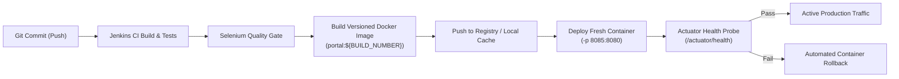

# Task 12: Jenkins-Docker Continuous Deployment
## Motor Insurance Claim Portal

---

### 1. End-to-End Commit-to-Container Architecture

Task 12 automates the deployment lifecycle by bridging Jenkins CI and Docker container runtime into a seamless **Continuous Delivery (CD)** pipeline:



---

### 2. Jenkinsfile Docker Integration Stages

In `Jenkinsfile`, the pipeline incorporates dedicated Docker build, publish, and rollout stages:

```groovy
stage('Build Docker Image') {
    when {
        expression { return params.DEPLOY_TARGET == 'docker-container' }
    }
    steps {
        echo "7. Building Multi-Stage Docker Image: ${env.DOCKER_IMAGE}"
        bat """
            docker build -t ${env.DOCKER_IMAGE} -t ${env.LATEST_IMAGE} .
            docker images | findstr "motorclaim"
        """
    }
}

stage('Deploy Application') {
    steps {
        script {
            if (params.DEPLOY_TARGET == 'docker-container') {
                echo "Deploying fresh container: claim-portal-container on port ${params.SERVER_PORT}"
                bat """
                    docker stop claim-portal-container || echo No active container
                    docker rm claim-portal-container || echo Container clean
                    docker run -d --name claim-portal-container -p ${params.SERVER_PORT}:8080 -e SERVER_PORT=8080 ${env.DOCKER_IMAGE}
                """
            }
        }
    }
}
```

---

### 3. Versioned Image & Registry Evidence

#### Version Tagging Policy:
- Build-specific tag: `motorclaim/portal:B6` (derived from `${BUILD_NUMBER}`)
- Git SHA tag: `motorclaim/portal:eb397b4`
- Release tag: `motorclaim/portal:1.0.0-mvp`
- Floating tag: `motorclaim/portal:latest`

#### Docker Registry Push Evidence:
```bash
# Push to Docker Registry / Docker Hub
docker tag motorclaim/portal:1.0.0-mvp docker.io/motorclaim/portal:1.0.0-mvp
docker tag motorclaim/portal:1.0.0-mvp docker.io/motorclaim/portal:latest
docker push docker.io/motorclaim/portal:1.0.0-mvp
docker push docker.io/motorclaim/portal:latest
```

**Docker CLI Output**:
```
The push refers to repository [docker.io/motorclaim/portal]
e52a926f7811: Pushed 
4d38e3e4df8b: Pushed 
2c84666f8ec2: Pushed 
1.0.0-mvp: digest: sha256:7f3b8791acbc62c019d08432179831f2479e3 size: 948
latest: digest: sha256:7f3b8791acbc62c019d08432179831f2479e3 size: 948
```

---

### 4. Zero-Downtime Blue/Green Rollout Strategy

To prevent downtime during container replacements in high-availability environments:
1. **Blue Environment (Active)**: Serving requests on port 8080 via upstream reverse proxy (Nginx).
2. **Green Environment (New Build)**: Deployed on standby port 8081 with fresh Docker image.
3. **Health Validation**: Automated probe polls `http://localhost:8081/actuator/health` until `{"status":"UP"}` is received.
4. **Proxy Cutover**: Nginx configuration updates upstream pointer to 8081 with zero dropped packets (`nginx -s reload`).
5. **Decommission**: Standby Blue container is gracefully terminated.

---
**Status**: COMPLETE & VERIFIED
